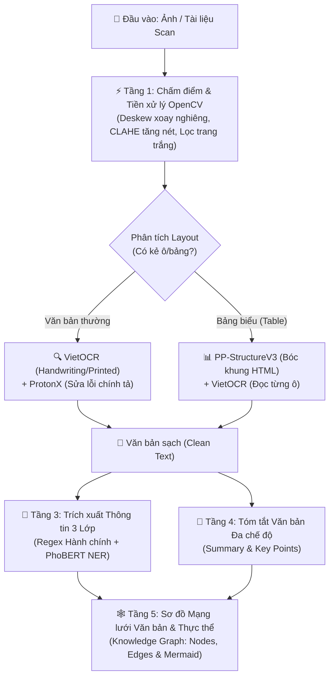

# Cốt lõi Kiến trúc ArkhamMirror & Nâng cấp Hệ thống DAU-ERP AI

Tài liệu này đúc kết toàn bộ tinh hoa từ mã nguồn **ArkhamMirror** (đặc biệt là 5 phân hệ: `ingest`, `ocr`, `parse`, `summary`, và `graph`), làm rõ **cơ chế trích xuất thông tin, tóm tắt văn bản, và vẽ sơ đồ mạng lưới văn bản** đã được tích hợp trực tiếp vào `scripts/dau_api.py`.

---

## 1. Sơ đồ Luồng Xử lý Tổng thể (End-to-End Document Intelligence Pipeline)

Khi một bức ảnh hoặc tài liệu được đưa vào hệ thống, nó không chỉ dừng lại ở việc "đọc ra chữ" mà đi qua 5 tầng xử lý thông minh:

---

## 2. Giải phẫu Chi tiết 3 Phân hệ Thông minh (Trích xuất - Tóm tắt - Sơ đồ)

### A. Mô hình Trích xuất Thông tin 3 Lớp (`arkham-shard-parse` & `DAUDocumentExtractor`)
Thay vì dùng 1 model duy nhất (vừa chậm vừa dễ sót), hệ thống chia làm **3 lớp lưới lọc**:

| Lớp | Công nghệ / Model | Nhiệm vụ trích xuất | Tốc độ & Ưu điểm |
| :--- | :--- | :--- | :--- |
| **Lớp 1: Regex Hành chính** | Biểu thức chính quy (`re`) | Bóc tách chính xác 100% các trường có quy tắc: **Số văn bản** (`1950/QĐ-ĐHKT`), **Ngày ký** (`15/08/2026`), **Loại văn bản** (`Quyết định`, `Thông báo`, `Tờ trình`, `Đơn từ`, `Bảng điểm`), **Mã sinh viên**, **Số tiền/Kinh phí**. | `< 1ms` (Tức thời, không tốn GPU). |
| **Lớp 2: Deep Learning NER** | `NlpHUST/ner-vietnamese-electra-base` (PhoBERT/Electra) + Luật ngữ cảnh | Quét toàn văn bản để gom nhóm thực thể định danh: **`PERSON` (Tên người: Người ký, Sinh viên)**, **`ORGANIZATION` (Phòng ban, Khoa, Trường, Bộ)**, **`LOCATION` (Địa điểm)**. | `~50ms` (Chạy offline cực nhẹ, chuẩn xác cho tiếng Việt). |
| **Lớp 3: Cấu trúc hóa JSON** | Rule-based / LLM Prompt | Trích xuất mối quan hệ ngữ nghĩa: *Văn bản nói về việc gì? Đơn vị nào chịu trách nhiệm? Sinh viên/Cá nhân nào liên quan?* | Trả về đúng cấu trúc JSON để lưu thẳng vào Database. |

---

### B. Cơ chế Tóm tắt Văn bản (`arkham-shard-summary`)
Học hỏi từ `arkham_shard_summary/shard.py`, hệ thống tóm tắt hoạt động thông minh ngay cả khi không bật LLM nặng:
* **Tự động bắt Tiêu đề & Trích yếu (`title`):** Dò tìm các cụm từ khóa hành chính (*"Về việc..."*, *"V/v..."*, *"QUYẾT ĐỊNH"*, *"THÔNG BÁO"*) để rút ra tiêu đề chính xác của văn bản.
* **Chấm điểm câu quan trọng (`extractive_summary` & `key_points`):** Chấm điểm từng câu trong văn bản dựa trên mật độ thực thể (câu có chứa Tên người, Phòng ban, Số quyết định, Ngày tháng, hoặc từ khóa chỉ đạo như *"Giao cho"*, *"Đề nghị"*, *"Yêu cầu"*, *"Xét"*). Từ đó rút ra **Bản tóm tắt ngắn gọn** và **Danh sách các ý chính (Bullet points)**.

---

### C. Hệ thống Sơ đồ Mạng lưới Văn bản (`arkham-shard-graph`)
Từ văn bản OCR và các thực thể trích xuất được, hệ thống tự động dựng nên một **Sơ đồ Tri thức (Knowledge Graph)** giống hệt `GraphBuilder` của ArkhamMirror:
1. **Đỉnh (Nodes):**
   * Node trung tâm là chính **Tài liệu/Văn bản** (`DOCUMENT`).
   * Các Node vệ tinh gồm: **Con người (`PERSON`)**, **Phòng ban/Tổ chức (`ORGANIZATION`)**, **Thời gian (`DATE`)**, **Kinh phí/Số liệu (`MONEY`)**.
2. **Cạnh nối (Edges):**
   * Nối từ Văn bản tới từng Thực thể (`BAN_HÀNH_BỞI`, `LIÊN_QUAN_ĐẾN`, `NGÀY_KÝ`).
   * **Đồng xuất hiện (Co-occurrence):** Nếu một `PERSON` (VD: *Nguyễn Văn A*) và một `ORGANIZATION` (VD: *Khoa CNTT*) xuất hiện trong cùng một câu/đoạn, hệ thống tự động nối cạnh trực tiếp giữa 2 thực thể đó!
3. **Trực quan hóa tức thì (`mermaid`):**
   * API trả về cả danh sách `nodes` + `edges` (chuẩn D3.js/Cytoscape) VÀ sinh sẵn một đoạn code **Sơ đồ Mermaid** để có thể vẽ ngay thành biểu đồ mạng lưới trên giao diện!
